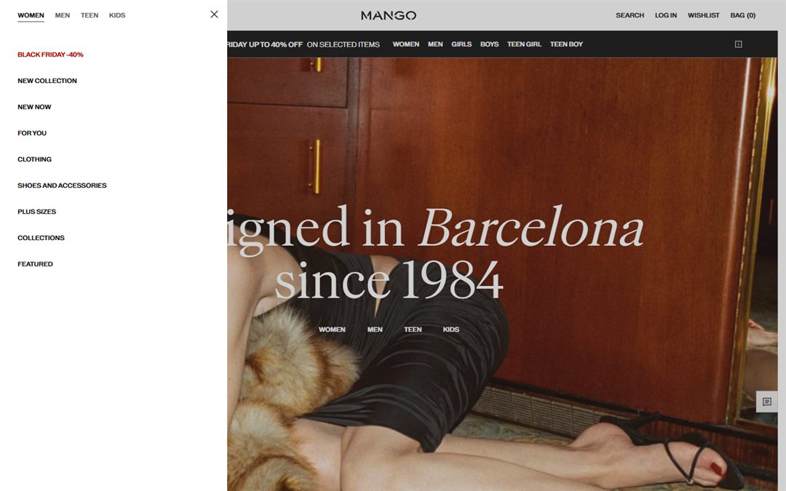
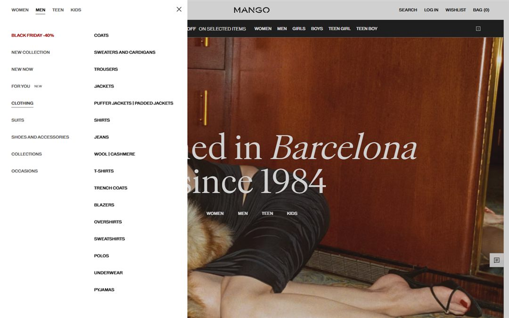
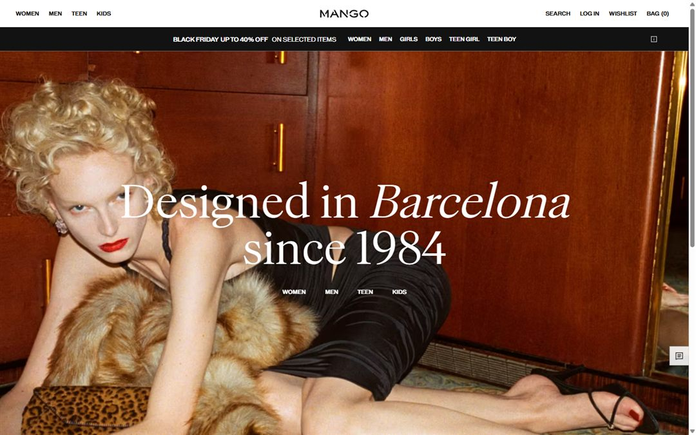
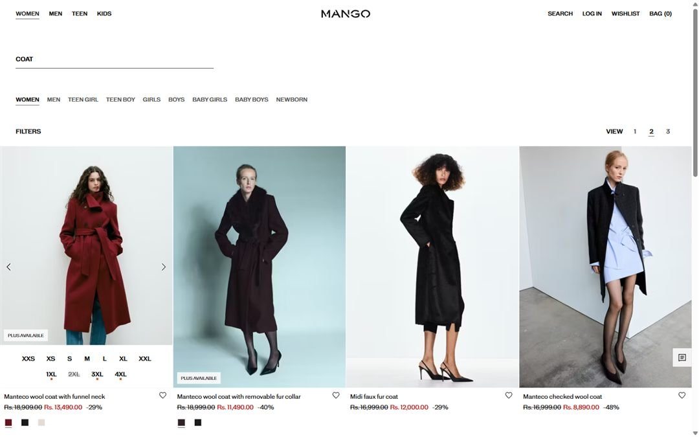
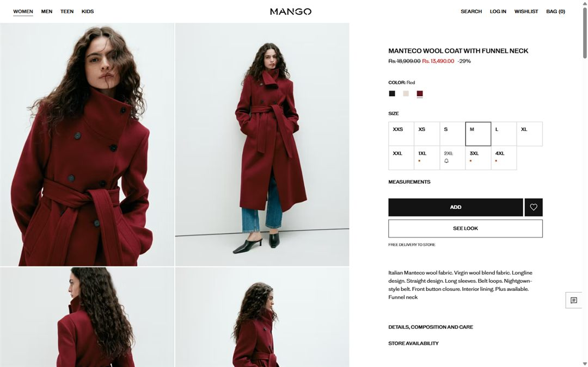
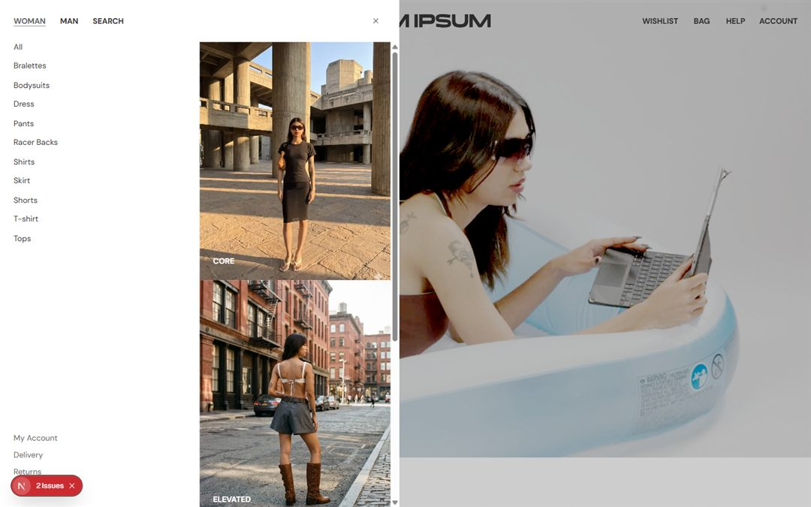
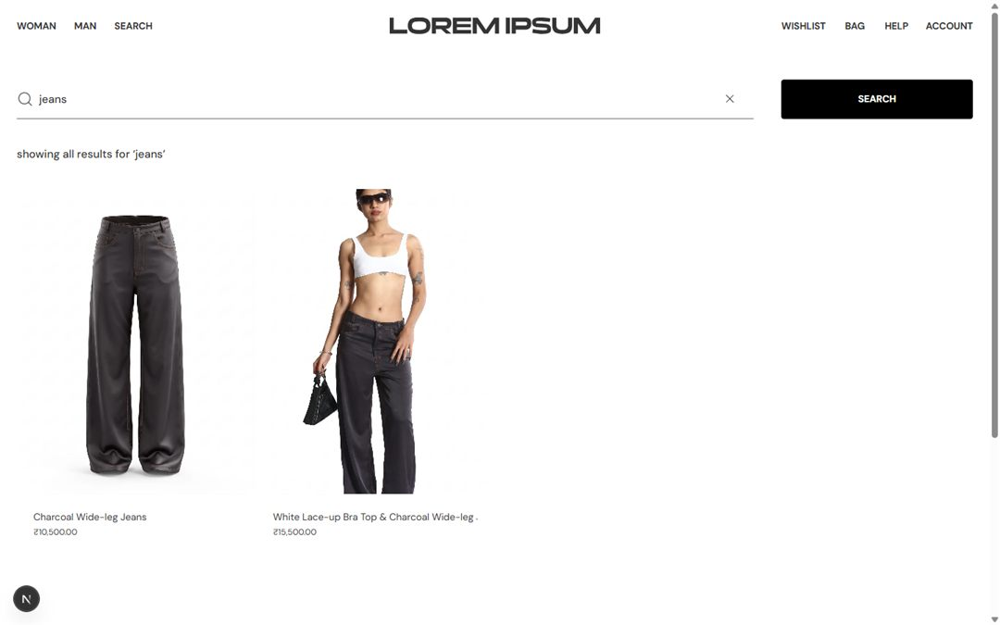

# Mango hover and motion study

Read-only study of `shop.mango.com` at 1440 × 900 on 23 November 2026, compared with the built
storefront. The India/English site was used because it resolves without a redirect. Values are
computed styles and bounding boxes, not screenshot estimates. The captures for this pass are in
`tmp/mango/` and `tmp/local/` (both ignored); nothing on Mango was submitted or purchased.

## Design idea: the image holds, the interface moves

Mango's motion language is unusually quiet. Photography is the anchor: product and editorial images
do not zoom, crossfade, or swap on hover. What moves is the interface around them — a 1 px rule that
travels between labels, a control that surfaces, a panel that reveals. Selection is expressed by a
rule that stays, not by a heavy fill.

That is the direction worth taking: **still photography, moving rules**. It suits a high-fashion
catalogue better than the template's current kinetic tells (image swap on hover, image zoom, filled
hover states), and it maps directly onto the ink/paper system already in `app/globals.css`.

Three rules follow from it:

1. The product image never changes or transforms because the pointer entered the card.
2. A 1 px underline is the universal hover/selection mark; fills are reserved for primary actions.
3. Hover previews; it never commits a size, variant, or navigation.

## What Mango does

### Navigation

The closed bar is text only. Hovering a section label changes it from `#131313` to `#434343`; there
is no underline until a panel is open.

The panel repeats the section bar at its top and adds the selection model:

| Element       | Rest                       | Hovered / selected                  |
| ------------- | -------------------------- | ----------------------------------- |
| Brand label   | `#131313`                  | hover `#434343`, selected `#131313` |
| Non-selected  | `#5b5b5b` while panel open | —                                   |
| Underline     | none                       | 1 px, brand colour                  |
| Section rail  | `#131313`                  | hover `#434343`, siblings `#5b5b5b` |
| Section label | 12 px / 600, 12 px padding | 1 px underline, 4 px below the text |
| Panel         | hidden                     | 416 px wide, full height            |

- Hovering another brand label switches the panel contents immediately; the underline slides from
  the old label to the new one. The same underline remains after the pointer leaves, so hover and
  selection share one mark.
- Hovering a rail section switches the second column immediately and dims every other section.
- The underline is one absolutely positioned `span` whose `width` and `translate` are set from the
  active item. Transition: `0.5s cubic-bezier(.3,.85,.5,1)`.
- The panel reveals with `clip-path: inset(0 calc(100% - 416px) 0 0)` over the same 0.5 s curve. The
  page behind darkens with `rgba(66,66,66,.25)`.
- Text, border, and background transitions are `0.3s`; the only expressive move is the 0.5 s panel
  and underline.

Mango's implementation is not accessible: the menu opens on hover, Escape does not close the panel,
and focus is not managed. Copy the perceived behaviour, not the keyboard model.

### Home and editorial

The home page is a full-bleed campaign image with a centred display headline and plain category
links. Images do not move on hover. The only hover treatment is on text CTAs: `text-decoration:
underline 1px` with an `8px` offset.

There is no card chrome: no border, radius, shadow, zoom, or crossfade on the image.

### Product card

Measured on a four-column search result: card `355 × 594`, media `355 × 497.6`
(`aspect-ratio: 5 / 7`), nine images per product.

- The featured image stays in place on hover. There is no second-image swap and no transform.
- Left and right arrows (44 × 44) fade from `opacity: 0` to `1` over `0.3s ease-in-out`. They step the
  gallery only when clicked.
- A size strip is absolutely positioned at the bottom of the media:
  - `translateY(100%)` at rest, `translateY(0)` when the media is hovered or focus-within.
  - `0.3s var(--motion-easing-calm)` when it retracts; `0.5s var(--motion-easing-accent)` when it
    appears. The longer, softer curve is what makes the reveal feel like a glide rather than a snap.
  - 88 px tall for 10 sizes in two rows: white surface, 16 px padding, 8 px gap, 12 px labels.
  - Available sizes are ink; unavailable sizes are grey. Hovering one size fills it black.
  - The arrows shift up by the strip height so they keep their optical centre.
- Size targets are 24 px tall. That is below our 36 px minimum and must not be copied.

### Product page

- Size chips are `64 × 60` with a `1 px #c7c7c7` border. Hover changes border and text to `#434343`.
  Selected uses `#2a2a2a` plus a 1 px inset shadow, which reads as 2 px without shifting layout.
  Transition is `0.1s` on border-color and color only.
- Colour swatches are 14 px bullets inside a 34 px target. Selected and hovered swatches get a 1 px
  underline below the bullet, fading over `0.3s`; there is no ring.
- The gallery image does not move on hover; the cursor only signals zoom.

### Motion values

| Role                    | Value                            |
| ----------------------- | -------------------------------- |
| State colour / border   | `0.1s`–`0.3s`                    |
| Control reveal          | `0.3s ease-in-out`               |
| Standard easing         | `cubic-bezier(.3,.85,.5,1)`      |
| Expressive easing       | `cubic-bezier(.5,0,0,1)`         |
| Panel and underline     | `0.5s` on the standard easing    |
| Surface, border, radius | 1 px rules, no radius, no shadow |

## Where our build differs

| Surface        | Today                                                                                                                         | Mango-style direction                                                             |
| -------------- | ----------------------------------------------------------------------------------------------------------------------------- | --------------------------------------------------------------------------------- |
| Header nav     | Click-only modal panel, no enter/exit motion; pointing at the selected tab mutes it (`ink-muted`) while its siblings stay ink | Hover darkens and underlines the target; siblings dim; panel reveals over 500 ms  |
| Menu panel     | Selected tab has a static 4 px underline; rail links only fade to `ink-muted`                                                 | One 1 px underline that travels; rail section hover underlines + dims siblings    |
| PLP card       | Static image, no hover affordance at all; size list is only in the caption                                                    | Image stays; arrows and a size strip surface on hover                             |
| Home card      | `scale 1.03` over 600 ms; no image swap                                                                                       | Remove the zoom, or reserve it for editorial tiles only                           |
| Search / rails | Default card swaps to a second image with a `display` toggle plus `scale 1.03`; this is the flash on hover                    | No hover swap on any product card; browse with arrows instead                     |
| PDP sizes      | 44 px links; selected is an ink fill; hover is a surface fill                                                                 | Keep the selected fill from Design I; make hover a 1 px border change, not a fill |
| Underline      | `--motion-underline: 350ms` is defined but unused                                                                             | Use it for the travelling nav rule and persistent tab marks                       |

The PLP is currently the opposite problem from the flash: it is completely inert on hover. The flash
comes from search, wishlist, related products and recommendations, which use the default card. One
card grammar should cover all of them.

## Proposed interaction grammar

| State                | Mark                                              | Motion                                        |
| -------------------- | ------------------------------------------------- | --------------------------------------------- |
| Rest                 | Ink text; no chrome                               | None                                          |
| Hover / preview      | Ink text + 1 px underline; siblings `ink-muted`   | Underline `350ms`, colour `300ms`             |
| Selected             | Ink text + 1 px underline that stays, or ink fill | Same rule moves; no extra transition          |
| Revealed control     | Paper surface; no border or shadow                | Opacity + 8 px translate, `300ms`             |
| Panel                | Paper, 1 px rule at its edge                      | Clip-path wipe `500ms`, backdrop fade `300ms` |
| Disabled/unavailable | `ink-muted`, no underline, `cursor-not-allowed`   | Colour only                                   |

Use a fill only for primary actions and the PDP selected size (Design I draws it filled). Everything
else distinguishes itself with a rule.

## Surface plan

### Header and menu

- Add the travelling 1 px underline to the panel's brand bar. Keep one absolutely positioned span per
  bar, measured from the active/hovered item, with `translate` and `width` transitioned over
  `--motion-underline`. On the closed header, a per-item `::after` (scaleX 0 → 1) is enough.
- In the open panel, hover or focus a brand to switch the contents immediately, exactly like a click.
  Keep `aria-pressed` for the committed brand and keep Escape, focus return and the existing focus
  loop.
- Dim non-target items with `:has()`: when the group is hovered, every item except the hovered one
  drops to `ink-muted`; the committed item returns to ink on pointer leave.
- Give the panel a clip-path reveal (`inset(0 100% 0 0)` → `inset(0)`) over `--motion-long` and a
  backdrop fade over `--motion-base`. Reuse the mobile menu's visibility-delay pattern so the panel
  stays painted through the close wipe.
- Do not open a modal on hover. If we want hover-to-open later, the desktop panel has to stop taking
  focus and locking scroll first; as built, accidental hovers would be disruptive. Hover preview
  inside an already-open panel captures the feel without that cost.
- The rail needs no second flyout column for our information architecture. Add the underline and
  sibling dimming only; keep the tiles as they are.

### Product catalog

- Remove the hover image swap and the `scale 1.03` from every product card. Keep the image static.
- Add arrows only when a product has more than one image: 36 × 36 targets (our minimum), 16 px
  chevrons, `opacity-0` → `1` over `--motion-base`, visible on `group-focus-within` and on
  `pointer-coarse` (where there is no hover).
- Add the size strip from the Design I hover frame (`9:5051`) rather than inventing a new overlay:
  paper surface at the bottom of the media, `translateY(100%)` → `0` over `--motion-base` with
  `--ease-standard`, controls shifted up by the strip height.
- Keep the strip to one row of at most six sizes. That fits a 360 px card and a 44 px target height;
  Mango's 88 px/two-row strip does not fit our target-size contract, and its 24 px targets fail it.
- A size in the strip must not add to cart on hover or click. Link it to the PDP with that size
  selected, or open the existing Quick Shop with the size resolved. Availability must come from
  Shopify variants; until `ProductCard` carries per-value availability and all gallery images, the
  strip is a display-only preview and must not claim a size is available.
- Keep Quick Shop and wishlist on home, search and rails. On PLP, the strip is the only reveal so the
  two affordances do not compete.
- On touch, no arrows appear on hover and no strip is hidden behind hover. Either show the size range
  in the caption as today, or open the same strip on tap.

### Home and editorial

- Remove image zoom from product cards. Editorial tiles may keep a single, slow 1.03 scale if the
  photography needs a sign of life; otherwise underline the label on hover instead.
- Do not add a second image behind editorial tiles. Keep the campaign frame still.

### Product page

- Keep the Design I selected size fill; change the unselected hover from a surface fill to a 1 px
  `ink` border with ink text. The fill currently reads as a second selection.
- Keep the colour swatch ring that Design I draws. If we want the underline idiom here too, apply it
  to the swatch label, not to the bullet; do not replace the ring with an underline in this pass.
- Use `--motion-fast` for border/colour changes. Do not animate the gallery on hover.

### Cart, search, filters

- These already use 300–400 ms sheet motion. Leave the geometry; only align their selected tabs and
  links to the underline grammar so the site has one state language.
- Mango underlines the active Bag label. Our header utilities can adopt the same persistent mark when
  a surface is active.

## Do not copy

- The 416 px menu width, 88 px overlay and 24 px size targets. Our targets are 36 px minimum and our
  panel is 709 px with product tiles.
- Hover-to-open modal behaviour and the missing Escape/focus handling.
- Mango's red promotion colour and sale typography; our commerce accent stays in the error tokens.
- Nine images per card. Two to four is enough for a first arrow pass; load later images on intent.
- Underline on absolutely every control. Reserve it for navigation, tabs and text CTAs; buttons keep
  their own fill/outline states.

## Open decisions

1. **Does the closed header open on hover?** Recommendation: no. Add the underline and dimming, keep
   click/keyboard opening, and make hover preview inside the open panel. Revisit only if the desktop
   panel becomes non-modal.
2. **Is the PLP size strip actionable in phase one?** Recommendation: no. It is a preview until the
   product-card query carries variant availability and gallery images; then link each size to the PDP.
3. **Do editorial tiles keep the 1.03 zoom?** Recommendation: remove it from product cards, keep it on
   editorial tiles only, at `--motion-image`. If the page should be fully still, underline the tile
   label instead.

## Verification for implementation

- Measure at 1440, 1100, 750 and 390; confirm no layout shift on hover or selection.
- Keyboard: tab to every trigger, open with Enter/Space, move the selection with arrows if the menu
  behaves as a menu, Escape closes and returns focus, focus is never left on an invisible control.
- Touch: no hover-only reveal; the card and menu are usable without a pointer.
- Reduced motion: the global `prefers-reduced-motion` rule must cover the new underline, clip-path and
  strip transitions; no JS-driven motion when reduced motion is requested.
- Confirm the PLP card still meets the 36 px target minimum and the one-row strip does not overflow a
  360 px card.
- Confirm no image request is added for a card until its arrow is used.

## Evidence

Desktop 1440 × 900, Chromium. Mango is read-only; the local pass used the seeded catalog.

| State                     | URL                                                                                                  | Capture                        |
| ------------------------- | ---------------------------------------------------------------------------------------------------- | ------------------------------ |
| Mango home                | `https://shop.mango.com/in/en`                                                                       | `mango/home.jpg`               |
| Mango panel, Women open   | `https://shop.mango.com/in/en`                                                                       | `mango/nav-panel.jpg`          |
| Mango rail, Clothing open | `https://shop.mango.com/in/en`                                                                       | `mango/nav-rail.jpg`           |
| Mango card hover          | `https://shop.mango.com/in/en/search/women/q/coat?q=coat`                                            | `mango/plp-card-hover.jpg`     |
| Mango PDP size selected   | `https://shop.mango.com/in/en/p/women/coats/coats/manteco-wool-coat-with-funnel-neck/37017807/70/00` | `mango/pdp-size-selected.jpg`  |
| Our panel open            | `http://localhost:3000/`                                                                             | `mango/current-nav-panel.jpg`  |
| Our search card hover     | `http://localhost:3000/search?q=jeans`                                                               | `mango/current-card-hover.jpg` |

Measured values quoted above come from `getComputedStyle`, `getBoundingClientRect` and the CSSOM
rules on those pages, not from the images. Mango durations are
`--motion-duration-short1/3`, `medium2` (`.1s`, `.3s`, `.5s`), `--motion-easing-calm`
(`cubic-bezier(.3,.85,.5,1)`) and `--motion-easing-accent` (`cubic-bezier(.5,0,0,1)`).
